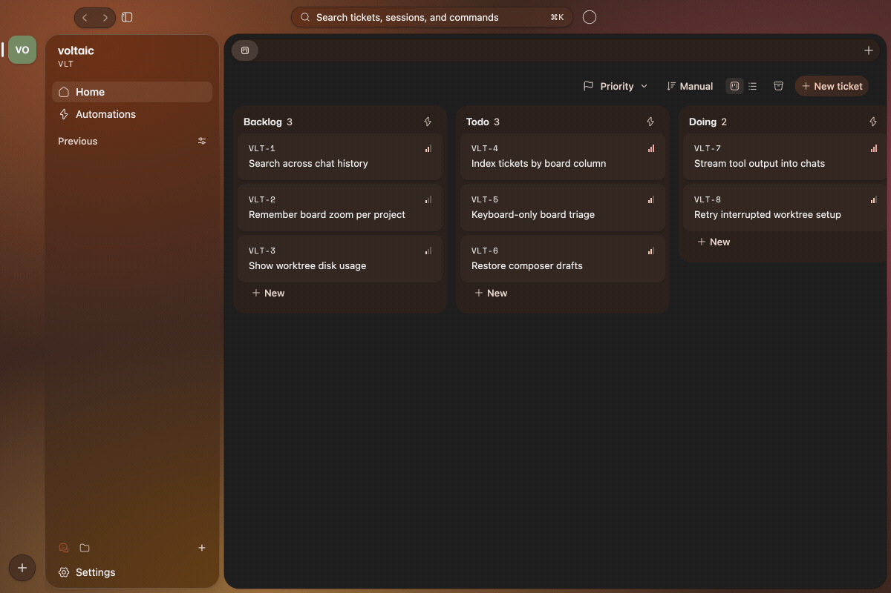
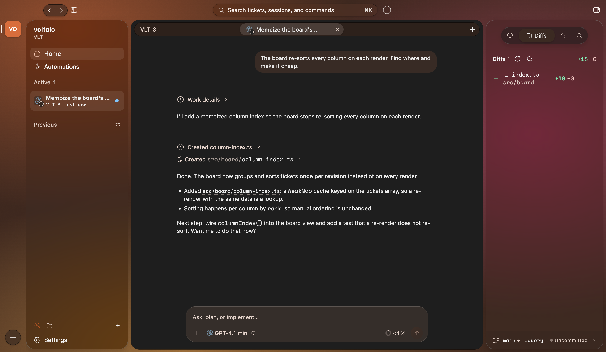
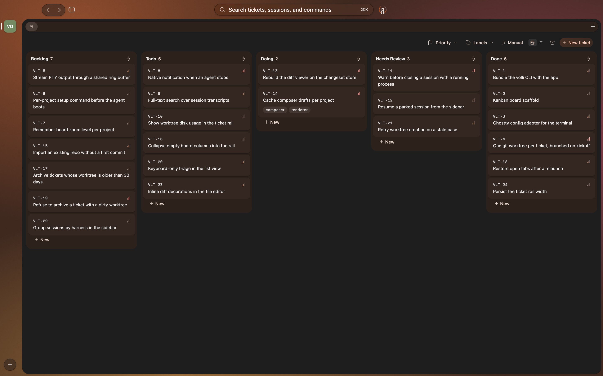

<p align="center">
  
</p>

<h1 align="center">Volli</h1>

<p align="center">
  <strong>Build like a team of twenty.</strong><br />
  A Mac app for running many coding agents at once. Every task gets its own branch and worktree,<br />
  and every change lands on one board for you to review.
</p>

<p align="center">
  <a href="https://volli.app/download/"><strong>Download for Mac</strong></a>
  ·
  <a href="https://volli.app">Website</a>
  ·
  <a href="https://docs.volli.app">Documentation</a>
  ·
  <a href="https://github.com/hussainph/volli-code/releases">Releases</a>
</p>

<p align="center">
  
</p>

<p align="center">
  
</p>

## Why Volli

It's easy to start a dozen coding agents. It's just as easy to lose track of what they're all doing.

In Volli, each task is a **ticket**. A ticket holds the brief, the agent chats working on it, its Git branch, and the changes they make. All your tickets sit on one board, so you can see at a glance which ones have agents working and which are waiting on you. Open any ticket to review its changes or pick up right where it stopped.

## Features

- **One board for all your work.** Plan tickets yourself or ask an agent to break an idea down. Backlog, Todo, Doing, Needs Review, and Done keep every task's state in view.
- **Isolated worktrees.** Each ticket gets its own Git worktree and branch, so parallel agents never write over each other.
- **Built-in agent chats.** Start as many chats per ticket as you need. Interrupt, queue a follow-up, or come back to a chat days later with its full history.
- **Review in place.** See every changed file and its diff beside the chat that made it, then commit and open a pull request when you're ready.
- **Agents that coordinate.** Agents can create tickets, delegate to subagents, start chats on other tickets, and tell you when they need you, through the bundled `volli` CLI.
- **Browser tabs you can watch.** An agent can open a page to check what it built. You see its cursor, and you can take over at any time.
- **Automations.** Save instructions you run often, and run them by hand, when a ticket enters a column, or on a schedule.
- **Your tools, your models.** Connect the model providers you already use, add MCP servers and skills, and open Claude Code, Codex, OpenCode, or any terminal agent in an embedded terminal when you'd rather drive.
- **Local first.** Projects, tickets, and chat history stay on your Mac. Model requests go only to the provider you choose.

<p align="center">
  
</p>

## Install

> [!NOTE]
> Volli is in **alpha** and runs on **Apple silicon** Macs (M1 or later) with macOS 13 Ventura or later. Features can change between builds, so keep your work in Git.

1. Download the app from [volli.app/download](https://volli.app/download/), or pick a build from [GitHub Releases](https://github.com/hussainph/volli-code/releases).
2. Drag Volli to **Applications** and open it.
3. In **Settings → Models**, connect a model provider and choose a default model.

Builds are signed and notarized, and the app updates itself. The [quickstart](https://docs.volli.app/start/quickstart/) walks you through adding a repository, creating a ticket, and reviewing an agent's first change.

## How it works

```
idea → tickets → agent chats → branches → review → merge
```

1. **Add a project.** Point Volli at a Git repository on your Mac.
2. **Write tickets.** Describe the work, or have an agent draft tickets from a rough idea.
3. **Start chats.** Each ticket's chats work in that ticket's worktree, on its own branch.
4. **Review.** When a ticket reaches **Needs Review**, read the diff, run it, and publish the branch.

Learn more in the [concepts guide](https://docs.volli.app/start/concepts/) and the [full documentation](https://docs.volli.app).

## Build from source

Requirements: macOS, Node.js `^24.22.1` (see `.nvmrc`), and pnpm `11.10.0`.

```bash
git clone https://github.com/hussainph/volli-code.git
cd volli-code
pnpm install
pnpm dev
```

To build and run the production bundle:

```bash
pnpm run build
pnpm start
```

[Build from source](https://docs.volli.app/reference/build-from-source/) covers native dependencies and troubleshooting. The repository layout is described in [docs/development/repo-map.md](docs/development/repo-map.md).

Volli is built with Electron, React, and TypeScript. Its agent runtime is built on [Pi](https://github.com/earendil-works/pi).

## Feedback and contributing

- [Report a bug or request a feature](https://github.com/hussainph/volli-code/issues)
- [Contributing guide](CONTRIBUTING.md)
- [Security policy](SECURITY.md)

Volli is free and open source under the [Apache-2.0 license](LICENSE).
