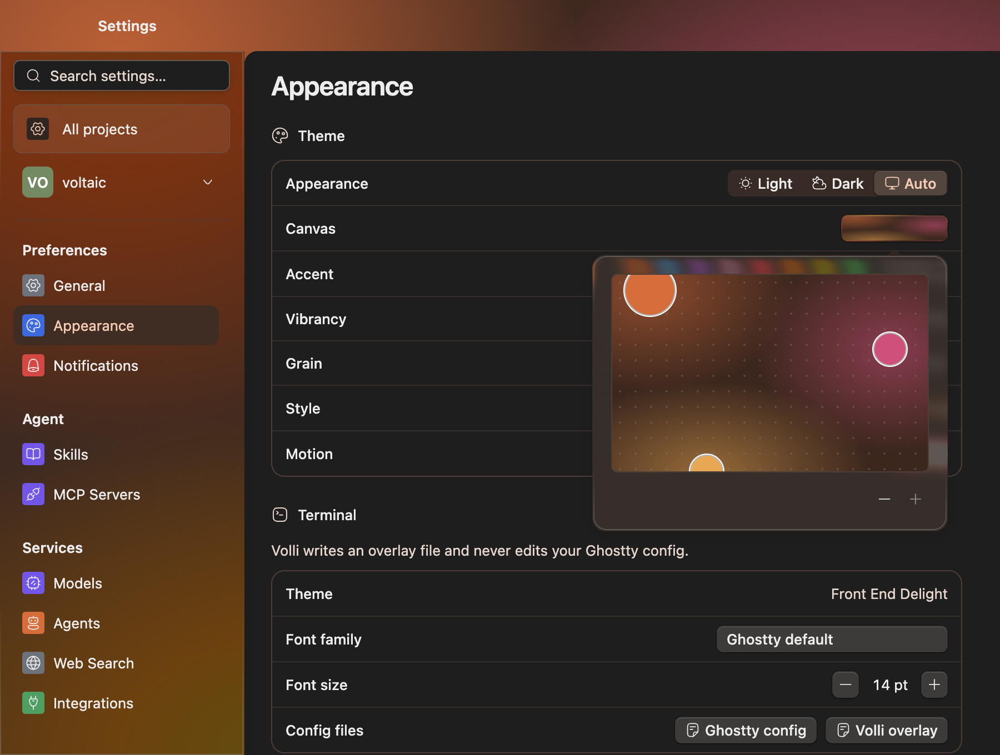

import { Aside } from "@astrojs/starlight/components";

Open **Settings → All projects → Appearance** to change the app's theme and
terminal appearance. Changes preview as you edit and save when you finish a
control. There is no apply button.

Volli derives its surfaces, text, borders, and accent from a **canvas** of one
to three colors. The default has orange, pink, and amber stops, with orange
(`#e8652a`) as its primary, 60% vibrancy, and 15% grain.

## What a canvas is

A canvas stores the colors and their positions, a primary color, vibrancy, and
grain. Colors pool around their positions in the window. The primary color
also supplies the app's accent and derived color tiers.

The same canvas can render in light or dark appearance. Terminal colors may
come from your Ghostty configuration instead.

## Edit the canvas

In **Theme**, select the **Canvas** preview to open **Colour placement**.
The pad represents your window at 16:10 proportions.

- Drag a circle to move a color.
- Click a circle without dragging to make it the primary.
- Use arrow keys to move a focused circle by 1%, or 5% with `Shift` held.
- Use **Add a colour** to add a stop, up to three. The minus control removes a
  non-primary stop. You must keep at least one color.

### Colors

Use **Accent** to choose a primary-color preset. **Custom** opens a saturation
and brightness pad, a hue slider, and **Primary colour hex**. The hex field
accepts `#rgb` or `#rrggbb`, with or without `#`. Valid values preview while
you type; `Enter` or leaving the field commits them. `Esc` in the custom
popover cancels an unfinished preview.

Under **Harmony**, choose **Complementary** for contrasting secondary colors
or **Analogous** for nearby hues. Changing the primary color recolors the
other stops without moving them.

### Vibrancy and grain

**Vibrancy** controls the canvas's saturation. **Grain** controls its noise
texture; 0% turns the texture off. Both sliders run from 0 to 100% and support
keyboard arrows.

### Contrast

Volli derives text, borders, and surfaces from the canvas. If you want more
separation between them, lower **Vibrancy** or choose a different accent.

## Light, dark, and auto

**Theme → Appearance** offers **Light**, **Dark**, and **Auto**. **Auto** follows
macOS. Appearance and canvas are separate settings, so a project can override
either without overriding the other.

**Style** offers **macOS** and **Modern** typography. **Motion** controls app
animations. Motion is app-wide; Style can also be overridden per project.

## Use a different theme for one project

In Settings, select the project row, then **Appearance**. **Configure →
Appearance** opens the same page.

Edit **Style**, **Mode**, or the canvas controls to create an override. You do
not need to switch to a custom scope first. A project's canvas and mode are
independent, so it can keep its own colors while following the app-wide
appearance.

An overridden value has a reset control. Open it and choose **Revert to global
default** to remove that override. The **Canvas** row also shows **Global
default** or **Project override**. **Overview** lists the project's overrides
in one place.

The **All projects** appearance page edits the global theme, even when the
project in your main window has its own theme. Its override links take you to
the projects that differ.

## What the terminal does

Volli reads your Ghostty configuration and layers its own overlay files on
top. In **All projects → Appearance → Terminal**, you can change **Font
family** and **Font size**, inspect the current **Theme**, and open **Ghostty
config** or **Volli overlay** from **Config files**.

- Without a Ghostty theme, the terminal uses Volli's canvas-derived background,
  foreground, cursor, and normal red, plus Volli's fallback ANSI palette.
- With a Ghostty theme, that theme supplies the terminal colors. A
  `theme = light:X,dark:Y` pair follows the app's current appearance.
- The project's **Appearance → Terminal → Config file** opens **This project's
  overlay** for project-specific settings.

<Aside type="note">
  Volli never edits your Ghostty config. Settings writes overlay files, which
  you can also open and edit yourself.
</Aside>

See [Settings and configuration](/guides/settings/) for the other preferences,
or [Troubleshooting](/reference/troubleshooting/) if terminal colors do not
match your configuration.
