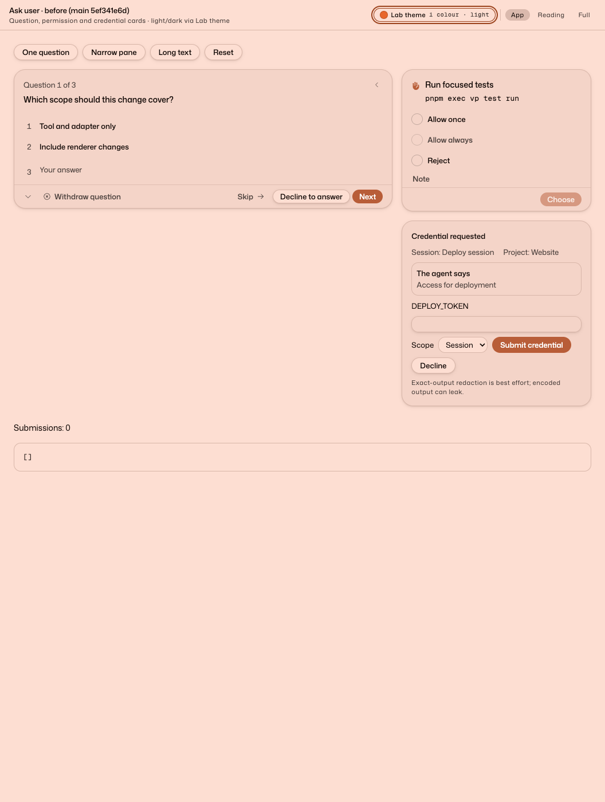
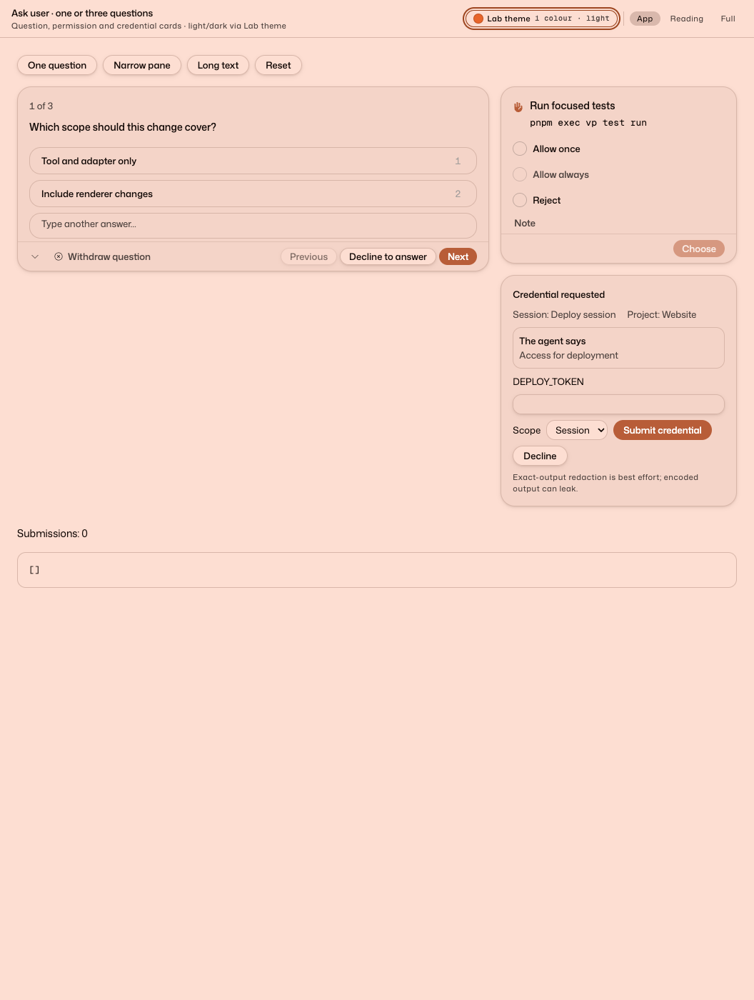
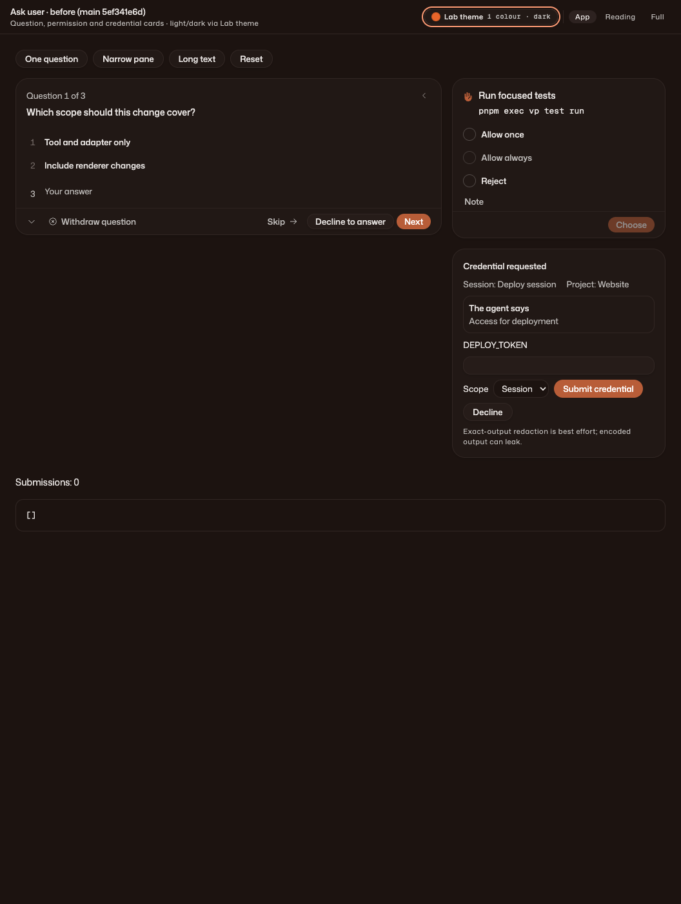
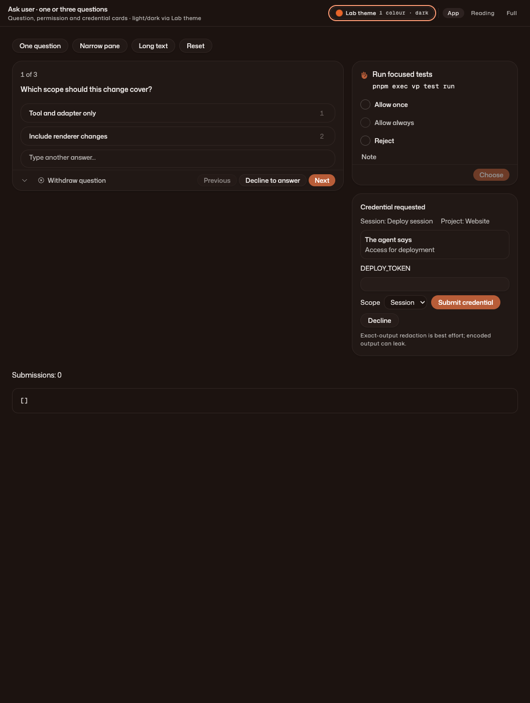
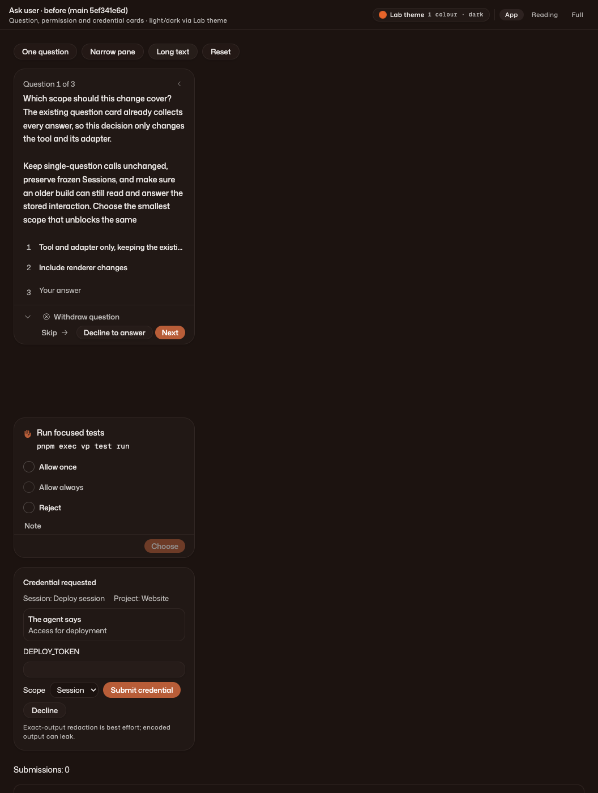
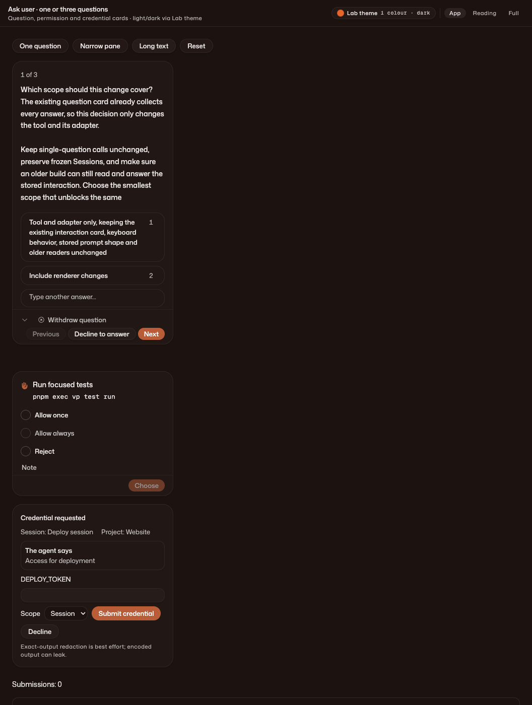

# VC-749: ask_user reference and visual evidence

The owner’s reference is [shadcn’s tool](https://github.com/shadcn-ui/chatbot-template/blob/main/tools/ask_user.ts), [question card](https://github.com/shadcn-ui/chatbot-template/blob/main/components/question-card.tsx) and [questionnaire](https://github.com/shadcn-ui/chatbot-template/blob/main/components/ui/questionnaire.tsx).

## Before and after

Browser-only Lab, port 5349. Before uses the production interaction component from main `5ef341e6d95cf02f6e44c363b712b00efacb926f`; after uses this change. Both receive the same fixtures, theme and viewport (1100 × 1400). Narrow is a 320px pane. Permission and credential fixtures appear alongside the question in every image; neither production card was changed.

| State | Before | After |
| --- | --- | --- |
| Light, three questions |  |  |
| Dark, three questions |  |  |
| Dark, narrow, long text |  |  |

Removed: Skip, redundant “Question” prefix, top previous-chevron, separate numbered “Your answer” trigger, option hover answer arrows, and selection-triggered submission. Replaced them with wrapping full-width numbered choice rows, inline “Type another answer…”, Previous / Next / Answer, and progress only for several questions. Minimize, attention, decline, withdrawal and the synchronous submit latch remain.

## Driven in the Lab

Independent visual-tier review fetched the reference and drove the actual component in Chromium:

- Light: three-question keyboard-only completion using number keys, Tab, Enter and inline text; three answers, submissions 0 → 1; another Enter stayed at 1.
- Light: one question, narrow + long text, typed answer submitted with Enter.
- Dark: one question, narrow, keyboard-only choice 2 and Tab/Enter submission.
- Dark: three questions, narrow + long text, Previous/Next and minimize/expand retained typed and selected answers; final payload included all three. This retention run used clicked navigation.
- Blank submission displayed “Choose an option” without submitting. Decline produced one empty-answer resolution and “Declined to answer”. Withdrawal displayed “Withdrew question”, with no answer submission.
- Long labels wrap, long question text scrolls internally, and narrow footer controls remain reachable. Permission and credential fixtures looked unchanged in both themes; neither was submitted.

This is browser Lab evidence, not a live Electron claim. External turn cancellation is covered through the real adapter/SQLite ledger test, not the Lab (which does not expose a backend cancellation fixture). Number shortcuts select without moving focus; Enter on a still-focused choice activates that row, and Tab reaches navigation as expected.

## Compatibility and implementation choices

New Sessions receive `questions: [{ question, choices }]` (1–4 questions, empty or 2–5 distinct nonblank choices). Free text is always available, single-choice only. Output is a JSON array of `{ question, answer }`; missing or unresolved answers are explicitly `{ answer: null, unanswered: true }`. A typed alternative takes precedence over selected choices, including when an older client sends both; raw typed whitespace is preserved in tool output (the current UI trims its submission).

Historical flat fields, schema, description and result bytes remain unchanged. The host records a birth-only `askUserQuestions: true` marker, never backfills it, and strips it from renderer payloads. Prompt and choice ids are generated record plumbing, not new model fields. No migration, public protocol change or dependency was added.

Both v0.2.1 (`f6ec540ca7ff14c6e403a4c8a91e840bba46dd1b`) and v0.2.2-canary.1 (`5ef341e6d95cf02f6e44c363b712b00efacb926f`) were exercised against a head-written SQLite interaction using their own stored/renderer codecs, presentation helpers and Session Engine. Each read all three prompts, submitted all answers and left the raw birth marker intact. Their decoded view ignores the new marker and their attach surface remains the old flat tool.
